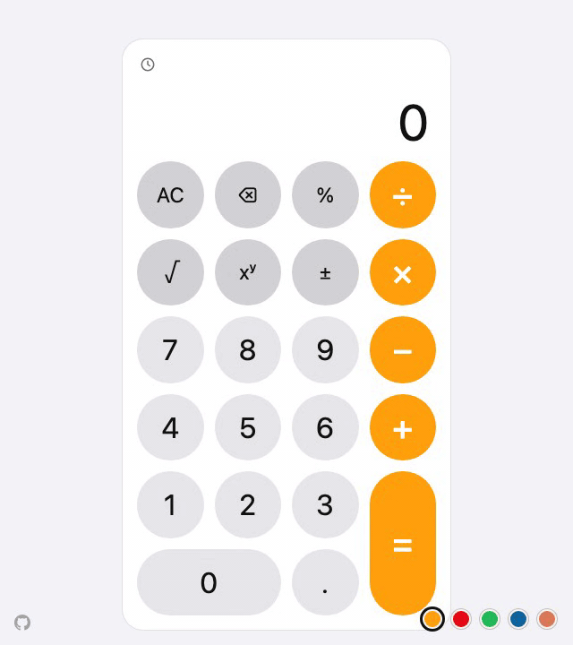
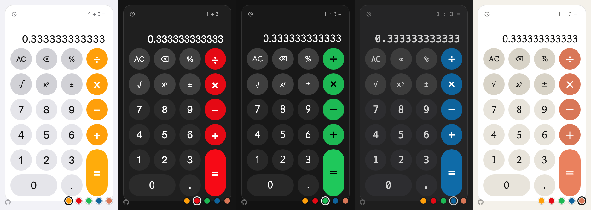

# Calculator Full-Stack

[](https://github.com/zgrgrcn/calculator-fullstack/actions/workflows/ci.yml)

**Live demo:** https://calculator.ozgurgurcan.com





A keypad calculator. The React + TypeScript frontend only builds the
expression; on `=` the whole token list goes to a Go REST microservice in one
request, which validates it, evaluates it with the usual precedence and answers
in JSON. The frontend does no arithmetic; single operations stay on `/api/v1/calculate`.

- Add, subtract, multiply, divide, power, square root and percentage; the
  expression builds as keys are pressed and nothing is sent until `=`, when the
  backend applies precedence (`2 + 3 × 4 = 14`, `2 ^ 3 ^ 2 = 512`, `196% × 5 = 9.8`)
- A small line shows the evaluated expression or the last answer (`Ans = 14`);
  the main line is sized by measuring, so no result is clipped from 320px up
- Keyboard input, five themes, and a history in localStorage shared across tabs
- Every key on screen from 320×568 and sideways phones up to the desktop;
  animations use transform and opacity only and stop under reduced motion
- JSON everywhere with one error envelope; CI gates each deploy on unit tests,
  coverage thresholds, 23 Playwright scenarios in four viewports and a mutation test

## Quick start with Docker

Requires Docker 25+ with Compose v2.

```bash
docker compose up --build
```

Open http://localhost:3000. nginx serves the built frontend and proxies
`/api/` to the backend container; the backend is also published on
http://localhost:8080 for direct API calls. Both containers have healthchecks
and memory limits (`docker compose ps` shows `healthy`).

## Running the backend and frontend separately

Requires Go 1.27 (any Go 1.21+ downloads it automatically through
`GOTOOLCHAIN=auto`) and Node 24.

```bash
make setup      # npm ci in frontend/ and e2e/
make backend    # Go API on http://localhost:8080
make frontend   # Vite dev server on http://localhost:5173, proxies /api to the backend
```

Run the two in separate terminals; `VITE_API_PROXY_TARGET=http://host:port make frontend`
changes the dev proxy target. Other targets: `make test`, `make coverage`,
`make lint`, `make media` (re-records the two images above; needs ffmpeg), `make help`.

The backend reads one environment variable, `PORT` (default `8080`).

## Architecture

```
┌──────────────────────────────┐        ┌──────────────────────────────┐
│ frontend (React 19 + TS)     │        │ backend (Go 1.27, stdlib)    │
│                              │  JSON  │                              │
│ Keypad ─▶ reducer (pure)     │ ─────▶ │ api: routes, decode, errors  │
│   ▲         │ request        │ /api/  │   │                          │
│   │         ▼                │ ◀───── │   ▼                          │
│ Display ◀─ useCalculator ──▶ client   │ expr: precedence ─▶ calc     │
└──────────────────────────────┘        └──────────────────────────────┘
        dev: Vite proxy /api → :8080        prod: nginx proxy /api → backend:8080
```

A key press goes into a pure reducer that only appends to a token list: an
operator key never computes anything. On `=` the reducer places exactly one
`request` holding the whole expression; a hook posts it to
`/api/v1/evaluate` and dispatches `resolved` or `failed`; the reducer then
shows the answer under the evaluated expression. Dependencies point one way:
`calc ← expr ← api ← cmd/server` in Go, and `reducer, expression, format,
client ← useCalculator ← components` in TypeScript, so each unit is tested on
its own.

## Interface

Fixed-height lines and a measured display size, so nothing clips; `=`, key
presses and tooltips animate transform and opacity only, off under reduced
motion; history across tabs, Enter on any focused control, pill keys on short
phones. Details: [docs/UI.md](docs/UI.md#interface-details).

## Themes

Five themes, each a block of CSS variables and a system font stack, no colours
in components: iOS (follows the system scheme), Netflix, Spotify, VS Code and
Claude, picked from the bottom-right swatches, kept in localStorage, drawn at
random on a first visit. What each references: [docs/UI.md](docs/UI.md#themes).

## API

Base path `/api/v1`. Every response is `application/json; charset=utf-8`.

| Method | Path                 | Purpose                                           |
| ------ | -------------------- | ------------------------------------------------- |
| `POST` | `/api/v1/evaluate`   | Evaluate a whole expression given as a token list |
| `POST` | `/api/v1/calculate`  | Run one operation                                 |
| `GET`  | `/api/v1/operations` | List operations with arity and symbol             |
| `GET`  | `/healthz`           | Liveness, `{"status":"ok"}`                       |

Operations and operand counts: `add`, `subtract`, `multiply`, `divide`,
`power` take two operands; `sqrt` and `percentage` take one.
`percentage` is `a ÷ 100`.

`/evaluate` takes `{"tokens":[...]}` where each token is
`{"type":"number","value":2}`, `{"type":"operator","op":"add"}` or a postfix
`{"type":"unary","op":"sqrt"}` applying to the operand before it. `× ÷` bind
tighter than `+ −`, `^` tighter still and right-associative, unary tightest.
The frontend sends exactly this on `=`.

```bash
curl -s -X POST localhost:8080/api/v1/evaluate \
  -H 'Content-Type: application/json' \
  -d '{"tokens":[{"type":"number","value":2},{"type":"operator","op":"add"},{"type":"number","value":3},{"type":"operator","op":"multiply"},{"type":"number","value":4}]}'
# {"result":14}

curl -s -X POST localhost:8080/api/v1/evaluate \
  -d '{"tokens":[{"type":"number","value":196},{"type":"unary","op":"percentage"},{"type":"operator","op":"multiply"},{"type":"number","value":5}]}'
# {"result":9.8}

curl -s -X POST localhost:8080/api/v1/calculate \
  -H 'Content-Type: application/json' \
  -d '{"operation":"add","operands":[1.5,2.25]}'
# {"operation":"add","operands":[1.5,2.25],"result":3.75}

curl -s -X POST localhost:8080/api/v1/calculate -d '{"operation":"sqrt","operands":[144]}'
# {"operation":"sqrt","operands":[144],"result":12}

curl -s -X POST localhost:8080/api/v1/calculate -d '{"operation":"divide","operands":[1,0]}'
# 422 {"error":{"code":"DIVISION_BY_ZERO","message":"cannot divide by zero"}}

curl -s -X POST localhost:8080/api/v1/calculate -d '{"operation":"sqrt","operands":[1,2]}'
# 400 {"error":{"code":"INVALID_OPERAND_COUNT","message":"wrong number of operands: sqrt expects 1 operand, got 2"}}

curl -s localhost:8080/api/v1/operations
# {"operations":[{"name":"add","arity":2,"symbol":"+"},{"name":"subtract","arity":2,"symbol":"−"}, ...]}
```

Errors always have the shape `{"error":{"code":"...","message":"..."}}`.
400 means the request itself is malformed or names something that does not
exist; 422 means the request is well-formed but the mathematics is
impossible.

| Status | Code                    | When                                                                                                                                  |
| ------ | ----------------------- | ------------------------------------------------------------------------------------------------------------------------------------- |
| 400    | `INVALID_REQUEST`       | Malformed JSON, unknown field, non-numeric or out-of-range operand (`1e999`), missing operation, more than one JSON value in the body |
| 400    | `UNKNOWN_OPERATION`     | `operation` is not in the registry                                                                                                    |
| 400    | `INVALID_EXPRESSION`    | `/evaluate` token list is empty or malformed: leading or doubled operators, a trailing operator, a unary with nothing before it       |
| 400    | `INVALID_OPERAND_COUNT` | Wrong number of operands for the operation                                                                                            |
| 422    | `INVALID_OPERAND`       | Square root of a negative number                                                                                                      |
| 422    | `DIVISION_BY_ZERO`      | Divisor is 0 (or −0)                                                                                                                  |
| 422    | `RESULT_NOT_FINITE`     | Result overflows or is undefined, such as `10^400` or `0^-1`                                                                          |
| 404    | `NOT_FOUND`             | Unknown route                                                                                                                         |
| 405    | `METHOD_NOT_ALLOWED`    | Wrong method; the `Allow` header names the right one                                                                                  |
| 413    | `PAYLOAD_TOO_LARGE`     | Body over 1 MiB                                                                                                                       |
| 500    | `INTERNAL_ERROR`        | A panic, recovered and logged; never a stack trace                                                                                    |

Numbers are IEEE 754 doubles, returned raw: `0.1 + 0.2` is
`0.30000000000000004` at the API, and the frontend rounds to 12 significant
digits for display. Integers are exact up to 2^53. Results that are NaN or
infinite are rejected before encoding, so a successful response always
carries a finite number.

In the compose stack nginx passes request bodies up to 2 MB through, so the
backend's own 413 reaches the client; above that nginx answers with the same
JSON body, and `server_tokens off` keeps its version out of headers and error
pages.

## Design decisions and assumptions

1. **One request per expression.** Keys only build a token list; `=` posts
   it to `/api/v1/evaluate`, where `expr` applies precedence and delegates
   every step to `calc`, so the frontend does no arithmetic and the error
   vocabulary is shared with `/calculate`, which stays for single operations.
   An earlier version evaluated chains step by step through `/calculate`; the
   current model follows the Google calculator, where an operator key only
   extends the expression.
2. **Precedence and associativity**, now in the backend: `+ −` bind weaker
   than `× ÷`, which bind weaker than `^`; `^` is right-associative like
   scientific calculators; postfix unary binds tightest.
3. **Percentage and square root are postfix tokens** (`196% × 5`),
   evaluated with the rest. Negation (`±`) edits the number being typed and
   is the only thing the frontend changes about a number.
4. **Validation on both layers.** The keypad constrains entry (15 digits,
   one decimal point, no leading zeros, a second operator replaces a trailing
   one, `=` is ignored while the expression ends with an operator); the API
   re-validates everything, including the token list's shape, and the UI
   shows the backend's own error message under the failed expression.
5. **No CORS code, by design.** The frontend and the API are served from one
   origin: Vite proxies `/api` in development and nginx does it in the
   compose stack. A client on another origin would need a small CORS
   middleware wrapping the mux in `backend/internal/api/handler.go`; it was
   left out as unneeded.
6. **400 versus 422.** Shape problems are 400; impossible mathematics is 422.
   Every error, including 404 and 405, uses the same JSON envelope.
7. **float64 end to end.** Arbitrary-precision decimals were out of scope;
   the display formatting hides binary noise, the API documents it.
8. **Go standard library only.** `net/http` method patterns, `encoding/json`
   with `DisallowUnknownFields`, `log/slog`. No third-party modules.
9. **Distroless backend image** with a self-probing `-healthcheck` flag,
   because the image has no shell or curl. The compose file has no host
   ports; `docker-compose.override.yml` adds them for local use only.
10. **History** is a localStorage list of `expression = result`, newest
    first, capped at 50, fed by the hook once a result is accepted and merged
    across tabs on every write; the reducer stays free of side effects.
    **Not built:** memory keys and rate limiting; everything else that was
    left out is listed below and under "What would come next".

The full design is in [docs/DESIGN.md](docs/DESIGN.md) and the task plan in
[docs/PLAN.md](docs/PLAN.md).

## Deliberately left as is

- **Repeat `=`.** A second `=` does nothing: the expression is complete, there is no "last operation" to reapply.
- **Operator replacement.** `+` then `×` replaces the pending operator instead of raising an error, as phone calculators do.
- **Delete.** Only Backspace is mapped; it removes the last digit, then the last token. Delete has no keypad meaning.
- **No paste.** Input is the keypad and single key presses; a pasted expression would need its own parser and errors.
- **Content-Type not checked.** Every body is parsed as JSON whatever the header says, so a plain `curl -d` works, as above.
- **No CORS.** One origin by design (decision 5); the Chrome extension under "What would come next" is where it returns.

## Testing and coverage

```bash
make test       # go vet + go test -race, then typecheck + lint + vitest
make coverage   # backend/coverage.html, docs/coverage.txt and frontend/coverage/index.html
make e2e        # compose stack up, Playwright against it, stack down
make mutate     # mutation test internal/calc; fails if a mutant survives
```

Backend: table-driven tests for every operation and edge case in `calc`
(division by zero and by −0, negative square root, overflow, NaN and Inf
operands, arity, unknown operation), a precedence and syntax table for
`expr`, and `httptest` tests for every route, status code and error code in
`api`, including malformed JSON, unknown fields, trailing data, oversized
bodies and the recover middleware.

Frontend: the reducer (entry rules, append-only operators, postfix unary
tokens, one request on `=`, continuing from the answer, failure and
recovery, stale request ids), expression formatting, the API client (every
error path and abort), the display's size buckets and measured fit, the
history store and hook with two tabs on one storage, the keyboard hook, the
tooltip controller, and the `Calculator` component against a fake
`/evaluate` backend (single request per chain, division by zero,
unreachable backend, keyboard input, disabled keypad while a request is
pending, operations handshake, Retry and the history dropdown).

CI fails when coverage drops below 90%: vitest's own thresholds for lines,
statements, functions and branches fail `npm run test:coverage`, and the
backend job parses `go tool cover -func` and fails under 90% statements.
Both percentages are printed in the job summaries of [the latest run on
`main`](https://github.com/zgrgrcn/calculator-fullstack/actions/workflows/ci.yml?query=branch%3Amain),
the reports are uploaded as artifacts, and `make coverage` writes the
per-function Go coverage (`go tool cover -func`) to the committed
[docs/coverage.txt](docs/coverage.txt). This table is the one place the
numbers live; measured on 2026-10-23 with `make coverage`:

| Layer              | Statements | Lines | Notes                                                                                       |
| ------------------ | ---------- | ----- | ------------------------------------------------------------------------------------------- |
| Go `internal/calc` | 100%       |       |                                                                                             |
| Go `internal/api`  | 94.6%      |       |                                                                                             |
| Go `internal/expr` | 97.8%      |       |                                                                                             |
| Go `cmd/server`    | 90.2%      |       | `main` is one line calling the tested `realMain`                                            |
| Go total           | 95.1%      |       | gate 90% over `./cmd/...` and `./internal/...`; `tools/mutate` has no tests and is excluded |
| Frontend           | 98.7%      | 99.5% | branches 95.9%, functions 99.2%; 90% thresholds enforced                                    |

### End-to-end tests

23 Playwright scenarios run against the compose stack in four projects
(Desktop Chrome, iPhone SE, 320×568, 667×375): a size check in every project,
arithmetic and error paths, history across reloads and tabs, keyboard access,
reduced motion and the 1.1 MB POST; 80 runs in 35 seconds in CI, four workers,
two-minute cap, and the deploy job needs them. The list: [docs/UI.md](docs/UI.md#end-to-end-scenarios).

### Mutation testing

`make mutate` runs [`backend/tools/mutate`](backend/tools/mutate/main.go),
a small mutation tester for `internal/calc` only. It flips every binary
operator (`+ - * / < <= > >= == != && ||`) and bumps every numeric constant
by one, one site at a time, reruns the package tests against each mutant in
a scratch copy of the module, and fails if any mutant survives.

What it proves: coverage shows which lines the tests execute; a 47 of 47
kill score shows the assertions would notice a wrong operator, a wrong
constant or a flipped comparison anywhere in the arithmetic. Writing it
found two real gaps: nothing tested a negative-infinity operand or result,
so `math.IsInf(x, 0)` could have become `math.IsInf(x, 1)` unnoticed, and
the zero result returned with every error was unasserted. It stays out of
`make test`, runs in its own CI job in about half a minute, and the deploy
job needs it.

## Deployment

The live demo is the compose stack on a self-hosted Coolify server, built from
`main`; the `deploy` job in [ci.yml](.github/workflows/ci.yml) calls the Coolify
webhook only after the backend, frontend, e2e and mutate jobs pass, with the
`COOLIFY_TOKEN` and `COOLIFY_WEBHOOK_URL` secrets (skipped with a notice while
unset). Setup and limits: [docs/DESIGN.md §27](docs/DESIGN.md#27-deployment-as-built-2026-10-23).

## Project structure

`backend/` is the Go module (`cmd/server`, `internal/calc`, `internal/expr`,
`internal/api`, `tools/mutate`); `frontend/` the Vite app (`src/api`,
`src/calculator`, `src/components`, `src/theme`, `src/history`, `src/tooltip`,
`nginx.conf`); then `e2e/`, `docs/` (DESIGN.md, UI.md, PLAN.md, coverage.txt,
media/), `deploy/`, `docker-compose.yml` and `.github/workflows/`. The annotated
tree: [docs/DESIGN.md §29](docs/DESIGN.md#29-repository-layout-as-built-2026-10-23).

## AI usage

Built with Claude Code (model Fable 5.1) in the Claude desktop app: a
structured brainstorming session produced the spec ([docs/DESIGN.md](docs/DESIGN.md)),
a task plan derived from it ([docs/PLAN.md](docs/PLAN.md)), then execution task
by task, with the tests written from the plan's test tables and committed with
the code, one commit per task. Every prompt I sent, including multiple-choice
answers, is in [PROMPTS.md](PROMPTS.md), verbatim and in order.

## What would come next

Six steps, each with what it requires in
[docs/DESIGN.md §28](docs/DESIGN.md#28-next-steps-2026-10-23): decimal
arithmetic, server-side history behind authentication, share links, a shared
live session, a Chrome extension (which needs the CORS middleware decision 5
left out) and request ids with metrics.
